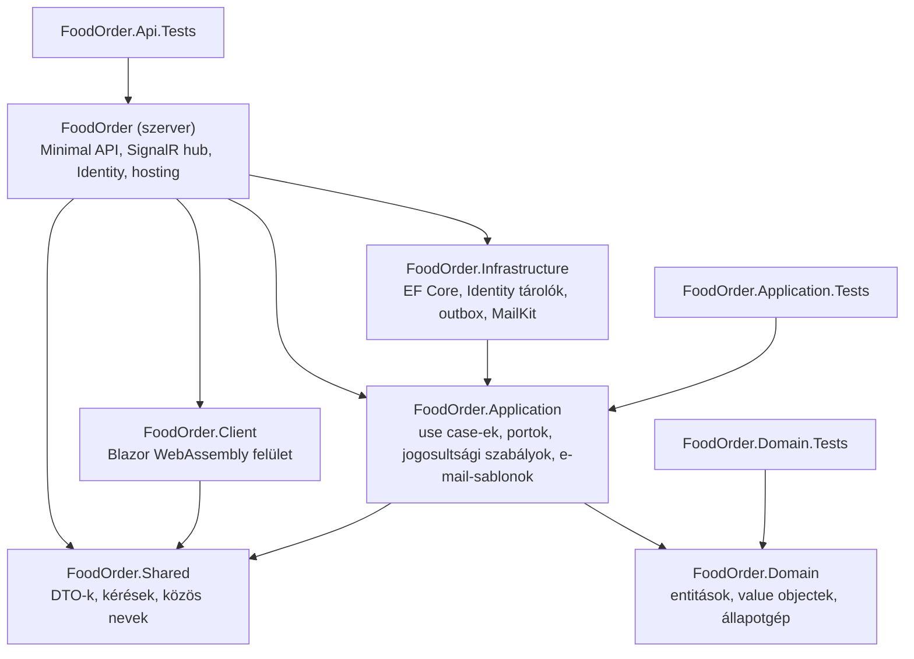
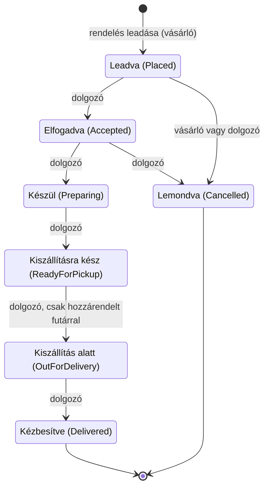

# FoodOrder

Ételrendelő webalkalmazás a *Korszerű webtechnológiák* tárgy féléves projektjeként. A vásárló böngészi az étlapot, kosárba tesz, rendelést ad le, és valós időben követi a rendelése állapotát. Az éttermi dolgozó kezeli az étlapot és a futárokat, és végigviszi a rendeléseket az állapotokon. Minden leadásról és állapotváltásról e-mail megy a vásárlónak.

**Technológia:** Blazor Web App (.NET 10, WebAssembly kliens), Minimal API, Clean Architecture, EF Core 10 + SQL Server LocalDB, ASP.NET Core Identity (süti), MailKit (outbox mintával), SignalR, xUnit.

## Követelmények lefedése

| Követelmény | Megvalósítás | Ellenőrző teszt |
|---|---|---|
| Ételek listája | `Dish` entitás, `GetMenuHandler`, `GET /api/dishes` (névtelenül is), Étlap oldal | `AuthorizationTests.Menu_IsVisibleWithoutLogin` |
| Új rendelés | `PlaceOrderHandler`, `POST /api/orders` (csak vásárló), Kosár oldal | `PlaceOrderHandlerTests`, `OrderLifecycleTests` |
| Állapotváltás csak megengedett sorrendben | `OrderStatus` value object átmenettáblája, `Order.ChangeStatus`, `AllowedNextStatuses` a DTO-ban | `OrderStatusTests`, `ChangeOrderStatusHandlerTests` |
| **Kritikus szabály:** a kézbesített rendelés nem kerülhet vissza Készül állapotba | `InvalidStatusTransitionException` → HTTP 409, magyar ProblemDetails | „Kézbesített rendelés nem kerülhet vissza előkészítésbe” – mindhárom tesztprojektben (Domain, Application, API), `CriticalRule` kategóriával |
| Szerepkörök: Vásárló, Éttermi dolgozó | Identity szerepkörök (`Customer`, `Staff`), `StaffOnly` / `CustomerOnly` policy, `OrderStatusPolicy` | `AuthorizationTests`, `CustomerAccessTests` |
| Külső értesítés (e-mail) | Outbox (`OutboxMessages` tábla) + `OutboxProcessor` háttérszolgáltatás + MailKit | `NotificationTests`, `PlaceOrderHandlerTests` |
| Push értesítés | SignalR hub (`/hubs/orders`), csoportok vásárlónként és a dolgozóknak, felugró értesítés | (böngészős végigjátszás, lásd [docs/demo.md](docs/demo.md)) |
| Entitások: Dish, Order, OrderItem, Courier | `FoodOrder.Domain/Entities` | `DishTests`, `OrderTests`, `CourierTests` |
| Value objectek: Money, OrderStatus | `FoodOrder.Domain/ValueObjects` | `MoneyTests`, `OrderStatusTests` |
| Use case: Étel felvétele | `AddDishHandler`, `POST /api/dishes` (csak dolgozó) | `AuthorizationTests.CreateDish_*` |
| Use case: Rendelés leadása | `PlaceOrderHandler` | `PlaceOrderHandlerTests` |
| Use case: Állapotváltás | `ChangeOrderStatusHandler` | `ChangeOrderStatusHandlerTests`, `OrderLifecycleTests` |
| Use case: Rendelés követése | `TrackOrderHandler`, `/rendeleseim/{id}` oldal, élő frissítés | `TrackOrderHandlerTests` |
| Párhuzamos módosítás kezelése | `Version` (optimista zárolás) → HTTP 409 | `SameExpectedVersionTwice_SecondRequestGets409` |
| Rétegszabályok | Clean Architecture függőségi irányok | `ArchitectureTests` (NetArchTest) |
| Biztonság | Szerveroldali jogosultság minden végponton, általános bejelentkezési hibaüzenet, HTML-kódolt e-mailek, biztonsági fejlécek | `SecurityTests`, `EmailTemplatesTests` |

## Architektúra



- **Domain:** üzleti szabályok, külső függőség nélkül. Az `Order` dönti el, hogy egy állapotváltás megengedett-e, és hogy futár nélkül nem indulhat kiszállítás.
- **Application:** a négy use case (és a kisebbek) handlerként. Csak portokon (`IOrderRepository`, `ICurrentUser`, `INotificationOutbox`, `IEmailGateway`, `IOrderUpdatePublisher` …) keresztül éri el a külvilágot. Itt van az `OrderStatusPolicy`: ki melyik állapotváltást kérheti.
- **Infrastructure:** a portok megvalósítása: EF Core (`AppDbContext`, repository-k), Identity tárolók, az outbox és a MailKit-küldő.
- **Szerver:** Minimal API végpontok, hitelesítés és policy-k, hibakezelés (magyar ProblemDetails), SignalR hub, a Blazor kliens kiszolgálása.
- **Client:** WebAssembly felület. Az adatokat kizárólag az API-ból kéri; nincs benne átmenettábla, a választható lépéseket a szerver adja.

**Egy állapotváltás útja:** a dolgozó a felületen rákattint a következő állapotra → `POST /api/orders/{id}/status` a rendelés verziójával → a handler ellenőrzi a láthatóságot (404), a verziót (409), a jogosultságot (403) és az átmenetet (domain, 409) → egyetlen mentésben kerül az adatbázisba az új állapot és az e-mail-esemény (outbox) → a mentés után a SignalR „OrderChanged” jelzést küld a vásárlónak és a dolgozóknak → a böngészők az API-ból lekérik a friss rendelést → a háttérszolgáltatás 5 másodpercen belül elküldi a levelet.

## Állapotgép



Futárt Elfogadva, Készül vagy Kiszállításra kész állapotban lehet hozzárendelni. A Kézbesítve és a Lemondva végállapot: ezekből nincs továbblépés.

## Futtatás

A lépések tiszta gépen, ebben a sorrendben működnek. A parancsok PowerShellben (vagy bármely terminálban) a repó gyökeréből futnak, ahol a `FoodOrder.slnx` van; gépspecifikus elérési út sehol nem kell.

### 1. Előfeltételek (gépenként egyszer)

- **.NET 10 SDK** – ellenőrzés: `dotnet --version` → `10.0.x`
- **Visual Studio 2026** az *ASP.NET and web development* munkaterheléssel (ez a LocalDB-t is telepíti), **vagy VS Code** a *C# Dev Kit* bővítménnyel és külön telepített *SQL Server Express LocalDB*-vel
- **Git**
- **SQL Server Management Studio** (nem kötelező, az adatbázis megtekintéséhez)

LocalDB ellenőrzése: `sqllocaldb info` – a listában szerepeljen az `MSSQLLocalDB`. Ezt a példányt az első kapcsolódás magától elindítja.

### 2. Forráskód és fejlesztői tanúsítvány

```powershell
git clone <a repó URL-je> FoodOrder
cd FoodOrder
dotnet dev-certs https --trust
```

A tanúsítvány a HTTPS-hez kell; a bejelentkező süti csak HTTPS-en működik.

### 3. Fejlesztői levelezőszerver

Külön terminálablakban indítsd el, és hagyd futni (részletek lent, az *E-mail: smtp4dev és user-secrets* résznél):

```powershell
dotnet tool install --global Rnwood.Smtp4dev
smtp4dev --smtpport 2525 --urls=http://localhost:5050
```

### 4. Build és tesztek

```powershell
dotnet build FoodOrder.slnx
dotnet test FoodOrder.slnx
```

A tesztekhez nem kell adatbázis és levelezőszerver.

### 5. Indítás

- **Visual Studio 2026:** nyisd meg a `FoodOrder.slnx` fájlt. A **FoodOrder** projekt legyen a Startup Project (jobb klikk → *Set as Startup Project*), az indítási profil **https**, majd F5.
- **VS Code vagy parancssor:**

  ```powershell
  dotnet run --project FoodOrder/FoodOrder --launch-profile https
  ```

  Ezután a böngészőben nyisd meg a https://localhost:7060 címet.

Az első indításkor (Development környezetben) az alkalmazás magától létrehozza a `FoodOrder` adatbázist a LocalDB-ben, lefuttatja a migrációkat, feltölti az étlapot és a futárokat, és létrehozza a tesztfiókokat. `Update-Database` vagy más kézi lépés nem kell. Bejelentkezés: lásd *Tesztfiókok*.

## Fejlesztői környezet

### Adatbázis: LocalDB és SSMS

A kapcsolati karakterlánc az `appsettings.json`-ban van:
`Server=(localdb)\MSSQLLocalDB;Database=FoodOrder;Trusted_Connection=True;…`

SSMS-ben: *Server name:* `(localdb)\MSSQLLocalDB`, *Authentication:* Windows Authentication, a **FoodOrder** adatbázis. A fontosabb táblák: `Dishes`, `Orders`, `OrderItems`, `OrderStatusChanges`, `Couriers`, `OutboxMessages`, valamint az Identity `AspNetUsers`, `AspNetRoles`, `AspNetUserRoles` táblái.

### Migrációk

A migrációk a `FoodOrder.Infrastructure/Migrations` mappában vannak (InitialCreate, AddIdentity, AddOutbox). Új migráció a Package Manager Console-ban:

```powershell
Add-Migration <Név> -Project FoodOrder.Infrastructure -StartupProject FoodOrder -ErrorAction Continue
```

Az `-ErrorAction Continue` azért kell, mert a Visual Studio 2026 Package Manager Console-ja a NuGet biztonsági figyelmeztetéseinél (NU1902) különben megállna. Parancssorból a `dotnet-ef` eszközzel (telepítés egyszer):

```powershell
dotnet tool install --global dotnet-ef
dotnet ef migrations add <Név> --project FoodOrder.Infrastructure --startup-project FoodOrder/FoodOrder
```

Az adatbázist Developmentben az alkalmazás indításkor frissíti; kézzel: `Update-Database -Project FoodOrder.Infrastructure -StartupProject FoodOrder`.

### E-mail: smtp4dev és user-secrets

Fejlesztéshez egy helyi SMTP-szerver, az smtp4dev fogadja a leveleket (indítása: *Futtatás*, 3. lépés). Az `appsettings.Development.json` erre mutat: localhost:2525, titkosítás és hitelesítés nélkül. A beérkezett leveleket a http://localhost:5050 oldalon látod. Ha az smtp4dev nem fut, az alkalmazás akkor is működik: a levél az outboxban vár, és a feldolgozó növekvő várakozással (10 mp, 30 mp, 2 perc, 10 perc) legfeljebb ötször próbálja újra.

Valódi szolgáltatóhoz (pl. Mailtrap vagy Gmail alkalmazásjelszóval) a beállításokat **user-secretsbe** tedd, soha ne az appsettings fájlokba. Visual Studióban: jobb klikk a FoodOrder projekten → *Manage User Secrets*. Parancssorból:

```powershell
dotnet user-secrets init --project FoodOrder/FoodOrder
dotnet user-secrets set "Smtp:Host" "sandbox.smtp.mailtrap.io" --project FoodOrder/FoodOrder
dotnet user-secrets set "Smtp:Port" "2525" --project FoodOrder/FoodOrder
dotnet user-secrets set "Smtp:UseStartTls" "true" --project FoodOrder/FoodOrder
dotnet user-secrets set "Smtp:UserName" "<felhasználónév>" --project FoodOrder/FoodOrder
dotnet user-secrets set "Smtp:Password" "<jelszó>" --project FoodOrder/FoodOrder
```

Az SMTP-beállításokat az alkalmazás indításkor ellenőrzi; hiányzó vagy hibás beállításnál magyar hibaüzenettel le sem indul.

### Tesztfiókok

Csak Development környezetben jönnek létre. A jelszó mindháromnál: `Demo123!`

| E-mail-cím | Név | Szerepkör |
|---|---|---|
| dolgozo@foodorder.hu | Nagy Péter | Éttermi dolgozó (Staff) |
| anna@foodorder.hu | Kiss Anna | Vásárló (Customer) |
| bela@foodorder.hu | Kovács Béla | Vásárló (Customer) |

Új vásárlói fiókot a felületen a *Regisztráció* oldalon lehet létrehozni. A `FoodOrder/FoodOrder/FoodOrder.http` fájl kipróbálható API-kéréseket tartalmaz bejelentkezés nélkül, vásárlóként és dolgozóként.

## Tesztek

| Projekt | Mit vizsgál | Esetek |
|---|---|---|
| `FoodOrder.Domain.Tests` | Entitások, value objectek, állapotgép | 80 |
| `FoodOrder.Application.Tests` | Use case-ek kézi fake-ekkel (mock-könyvtár nélkül): jogosultság, verzióütközés, outbox, publikálás sorrendje; az e-mail-sablonok HTML-kódolása | 24 |
| `FoodOrder.Api.Tests` | HTTP-integráció `WebApplicationFactory`-val, memóriabeli SQLite-on; biztonsági ellenőrzések; architektúraszabályok NetArchTesttel | 26 |

Futtatás:

- **Visual Studio:** *Test → Run All Tests* (Test Explorer).
- **Parancssor:** `dotnet test FoodOrder.slnx`

A kritikus szabály tesztje mindhárom rétegben „Kézbesített rendelés nem kerülhet vissza előkészítésbe” néven jelenik meg, és a `CriticalRule` kategóriába tartozik. Csak ezek futtatása: a Test Explorerben *Group By → Traits*, vagy parancssorból:

```powershell
dotnet test FoodOrder.slnx --filter "Category=CriticalRule"
```

A GitHub Actions munkafolyamat (`.github/workflows/ci.yml`) minden pushnál lefuttatja a restore-t, a buildet és a teljes tesztkészletet.

Az integrációs tesztekhez nem kell LocalDB és SMTP-szerver: a tesztek „Testing” környezetben futnak, minden tesztosztály saját memóriabeli SQLite-adatbázist kap, a levélküldő pedig egy leveleket rögzítő fake. A tesztek egymástól függetlenek, a futtatási sorrend nem számít.

## Biztonság

- **Titkok:** a repóban nincs jelszó vagy kulcs. Az `appsettings.json` SMTP-beállításai üresek, a LocalDB Windows-hitelesítést használ; valódi SMTP-fiók adatai csak user-secretsbe kerülhetnek. A `Demo123!` jelszavú tesztfiókok csak Development környezetben jönnek létre.
- **Jogosultság:** minden döntés a szerveren születik (policy-k a végpontokon, `OrderStatusPolicy` az Application rétegben, a vásárló rendeléseit az adatbázis-lekérdezés szűri). A `SecurityTests` ellenőrzi, hogy a szándékosan nyilvános végpontokon (étlap, bejelentkezés, regisztráció, kijelentkezés, `me`) kívül minden API- és hub-végponthoz bejelentkezés kell.
- **Hibaüzenetek:** váratlan hibánál a válasz általános magyar üzenet, belső részletek (kivételszöveg, stack trace) csak a naplóba kerülnek. Bejelentkezésnél nem létező fiókra, hibás jelszóra és zárolt fiókra ugyanaz az üzenet jön, hogy a válaszból ne derüljön ki, létezik-e a fiók.
- **Süti:** `HttpOnly`, `Secure`, `SameSite=Strict`; 5 hibás jelszó után 5 perc zárolás.
- **E-mail:** a felhasználótól származó szöveg (név, cím, megjegyzés, ételnév, futár) a HTML-levélben kódolva jelenik meg.
- **Bemenet és fejlécek:** egy rendelésben legfeljebb 50 tétel lehet; minden válasz `X-Content-Type-Options: nosniff`, `X-Frame-Options: DENY` és `Referrer-Policy` fejlécet kap.

## Ismert korlátok

- Az outbox egy példányban futó szerverre készült. Több szerverpéldánynál a bejegyzések zárolása kellene; a kézbesítés „legalább egyszeri” (ha a küldés utáni mentés hibázik, a levél újra kimehet).
- Az e-mail-sablonok kódban vannak, adminfelületen nem szerkeszthetők.
- Nincs jelszó-visszaállítás és e-mail-megerősítés; a valós idejű értesítés csak nyitott böngészőben működik (nincs Web Push vagy mobilértesítés).
- Egyetlen étterem, fizetés és ételképek nélkül.
- A bejelentkezés bevezetése (5. hét) előtt leadott rendelések vásárlóazonosítója még e-mail-cím, ezért ezeket csak a dolgozó látja.
- Az integrációs tesztek SQLite-on futnak, így az SQL Server-specifikus viselkedést (pl. a migrációkat) nem fedik le. SQLite alatt a `DateTimeOffset` értékek számként tárolódnak, mert az SQLite ezeket nem tudja rendezni és összehasonlítani.
- A tesztfiókok és a mintaadatok csak Development környezetben jönnek létre.
- Nincs IP-alapú kéréskorlátozás (rate limiting) és Content-Security-Policy; a jelszópróbálgatás ellen a fiókzárolás véd.

Az 5 perces bemutató forgatókönyve: [docs/demo.md](docs/demo.md).
